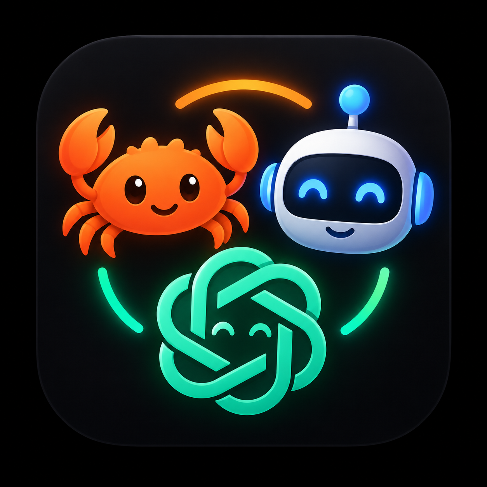

<p align="center">
  
</p>

<h1 align="center">AgentHub</h1>

<p align="center">
  A Windows desktop control centre for your GitHub repositories and the AI coding CLIs you run in them.
</p>

<p align="center">
  <a href="https://github.com/Daznl/AgentHub/actions/workflows/build.yml"></a>
  
  
  <a href="LICENSE"></a>
</p>

---

AgentHub treats the **repository as the workspace** and the AI CLI as an **interchangeable tool**. Register or clone a repo once, see its Git state at a glance, pull and push with one click, then launch Codex, Claude Code or Google Antigravity in that exact working directory, either in Windows Terminal or inside AgentHub's own multi-pane terminal cockpit.

It never stores API keys or provider credentials. Authentication stays with the tools you already use: each coding CLI, the GitHub CLI and Git Credential Manager.

## Contents

- [Features](#features)
- [Requirements](#requirements)
- [Getting started](#getting-started)
- [Configuration](#configuration)
- [Context window badge](#context-window-badge)
- [GitHub accounts and permissions](#github-accounts-and-permissions)
- [Usage limit cards](#usage-limit-cards)
- [Handoff convention](#handoff-convention)
- [Safety choices](#safety-choices)
- [Project layout](#project-layout)
- [Development](#development)
- [Roadmap](#roadmap)
- [License](#license)

## Features

### Local repositories

- Register existing Git clones or clone new ones by HTTPS or SSH URL.
- **Scan folder for repos** searches a chosen folder two levels deep, finds every Git clone and links each one to its GitHub remote.
- Colour-coded sync badges: `✓ Up to date`, `⇣ Behind`, `⇡ Ahead`, `✎ Modified`.
- Inspector shows current branch, changed-file count, ahead/behind counts and the origin remote.
- One-click `git fetch --prune`, fast-forward `git pull` and `git push`.
- Open the repository folder in Explorer or the remote on GitHub.

### GitHub repository browser

- Sign in to GitHub from inside the app. AgentHub drives `gh auth login --web`, shows the one-time code and opens the browser. The GitHub CLI keeps the token.
- Sign in to several accounts and switch between them from a dropdown. GitHub Enterprise Server hosts are supported.
- Lists every repository the active account can see: your own, shared with you and every organisation you belong to. Results stream in page by page.
- Repos are grouped by what GitHub says you may do: your own, organisation repos you can push to, organisation repos you can only clone or pull, and archived.
- Each card shows the owner and your role (Admin, Maintain, Push or Read-only). The Push button appears only where GitHub will accept a push.
- Filter by access, visibility or sync status. Clone and register any visible repo with one click.

### Terminal cockpit

- Run up to six interactive sessions side by side inside AgentHub, powered by Windows ConPTY and xterm.js in WebView2.
- Each pane can host Codex, Claude Code, Antigravity, PowerShell or Cmd, in any registered repository or any folder you pick. An idle pane shows a three-step launcher in place of the terminal: **① Repository** (🏠 Home, your user profile folder; a browsed folder; or a registered repository; a filter box appears past 8 entries, and **📂 Browse for another folder…** picks any folder), then **② Function type** (an agent CLI or shell; with Home chosen, also each saved SSH connection and **⚙ Manage SSH connections…**), then **③ Session**. Each finished step folds to one line with **Change**. Function types without recorded sessions (PowerShell, Cmd, Antigravity, SSH) start as soon as they are picked. The terminal stays hidden at full size underneath, so a CLI started from the launcher never sees a resize.
- Draggable splitters, **➕ Add Terminal**, per-pane close buttons (closing a pane with a running session asks first, because it ends that session) and **■ Stop all** (asks, then ends every running session).
- **Sessions survive restarts.** Each session runs in its own small `AgentHub.SessionHost.exe` process that owns the console and the CLI, so closing AgentHub, updating it and opening it again leaves Claude Code (or any shell) running, a turn in flight included. On start, AgentHub brings the panes back in their saved order and reattaches each one to its session, putting the terminal back exactly as it was (each pane saves its screen, scrollback and colours on close as `screen.json`, and the host replays only what the CLI wrote since); without a saved screen (a crash) the last 2 MB of output are replayed and the CLI is made to repaint. A session that ended while AgentHub was away shows its last screen and how it ended, with the launcher open on the same folder and CLI pointing at its transcript for a resume. Only the pane's ✕, **Stop**, **Relaunch** and **■ Stop all** end sessions; closing AgentHub never does. Hosts run from `C:\data\agenthub\host\<build>\`, a copy of the host keyed by its own bytes, so publishing a new AgentHub over the old one never touches a running session; records, replays, saved screens and logs sit under `C:\data\agenthub\sessions\<id>\` (`session.json`, `replay.bin`, `screen.json`, `host.log`). If the host cannot start, the session runs inside AgentHub as before and the pane says so. Off switch: `sessionsOutliveAgentHub` in settings.
- **Pane header.** The title row names the repository or folder. With no session the row below holds **📁 Repo context**, **🌳** (timeline), **🕘**, move and close; after a session ends, **New session** reopens the launcher over its output (**← Back to the last session's output** closes it again). While a session runs it slims down to the context badge, **📂** (opens the session's folder in Explorer), **Relaunch** (asks, then starts a fresh session of the same CLI in the same folder), **📁 Repo context**, **🌳**, move and close. Both layouts are the same height, so starting a session never resizes the terminal under the CLI's first screen.
- **Working and waiting indicators.** A pane running a coding CLI breathes blue while the CLI is producing output. When the CLI goes quiet, or rings the terminal bell, the pane pulses amber with a **⏳ WAITING FOR YOU** badge until you type. If AgentHub is in the background, the taskbar button flashes. Plain shells are never tracked.
- **SSH.** Save connections with the **🔐 SSH** header button: an optional name plus `user@host` or `user@host:port`. In a pane's launcher, choose **🏠 Home** and the saved connections appear under **② Function type**; picking one connects straight away. The session runs your own OpenSSH client inside PowerShell, so `exit` drops you back to a local prompt. AgentHub stores only the address; passwords and keys stay with `ssh`.
- **Copy and paste.** Select text and press **Ctrl+Shift+C** to copy, **Ctrl+Shift+V** to paste, or right-click a pane for **Copy** / **Paste**. Plain **Ctrl+C** still interrupts the running command.
- Launch an agent into a specific pane straight from a repository card, or into a new Windows Terminal tab.
- **Continue earlier sessions.** For Claude Code or Codex, launcher step **③ Session** offers **➕ New session** or any earlier session recorded for that folder (newest 30, titled, with time and length). Picking one runs the CLI's own resume (`claude --resume <id>`, `codex resume <id>`) in the pane. Sessions only left in the history archive are copied back first so the CLI can find them. A resumed pane's context badge and last prompt follow that exact session.
- **Context files.** **📄 Context** in the header opens the user-wide instruction file of each CLI in tabs: Claude Code `~/.claude/CLAUDE.md` (or `CLAUDE_CONFIG_DIR`), Codex `~/.codex/AGENTS.md` (or `AGENTS.override.md` when present, or `CODEX_HOME`), Gemini / Antigravity `~/.gemini/GEMINI.md`. **📁 Repo context**, in each pane header, opens the files at the root of the pane's folder (where its session runs, else the launcher's chosen location): `CLAUDE.md`, `AGENTS.md`, `GEMINI.md`, plus `.claude\CLAUDE.md` and `CLAUDE.local.md` when present, starting on the pane's CLI's file. Edit freely and **Save** (Ctrl+S) to write the real file; saving a missing file creates it. Line endings and byte order mark are kept, and the write is atomic. If the file changed elsewhere since it was opened, an untouched editor reloads it; with unsaved edits, Save asks whether to replace it, reload it, or keep editing.
- **Review context files.** **✨ Review** in the context window sends the editor's text (unsaved edits included) to Claude Code in print mode (`claude -p`) on your own Claude login, so no API key is needed; each review counts against your Claude usage. Every tool is turned off, MCP servers are not loaded, your own settings and `CLAUDE.md` are not loaded (so your personal rules do not leak into a repository's file), no session is saved, and it runs in the empty folder `C:\data\agenthub\review`, so it can only read the text it is sent. It suggests removing contradictions and duplicates, making vague rules specific, and tightening wording, keeping your intent. Claude Code replies with targeted edits in a fixed JSON shape (`--json-schema`), each naming only the first and last line of the passage it replaces, so long passages cost little to condense; a small file takes well under a minute, a 90 KB one about three (time limit 10 minutes, shown as it runs). The result gives an overall verdict, then each change with its reason and its removed / added lines, with its own **Apply** box; edits whose lines cannot be found once in the file are listed and left out; **Apply** puts the ticked changes into the editor, and nothing is written until you **Save**. The editor is read-only while a review runs; **■ Cancel review** stops it. The Claude Code command comes from the enabled Claude Code agent in Settings, else `claude`.

### Session history

- **🕘 History** in the header opens a window listing every Claude Code and Codex session per repository (plus Home and any folder opened from a pane), newest first, with the CLI's generated title, start time, duration and size.
- Pick a session to see its full history in order: every prompt you typed, every reply, the agent's visible thinking, each tool call with its input and each tool result (errors in red), plus slash commands, interrupts and compaction.
- Filter by kind with the chips, search the session, expand long tool output, and export what is shown as Markdown. **📄 Transcript file** shows the underlying file in Explorer.
- The open session is followed live: new messages append as the agent writes them, and the view follows the bottom unless you have scrolled up (**↓ Latest** jumps back).
- Each Cockpit pane's **🕘** button opens straight to that pane's session.
- Read from the transcripts the CLIs already write (`~/.claude/projects`, `~/.codex/sessions`), so sessions started outside AgentHub appear too and nothing is scraped from the terminal. Antigravity is not covered yet.
- **Permanent archive.** While AgentHub runs it copies every transcript (including sub-agent transcripts and saved tool output) into `C:\data\agenthub\history` at startup and every minute, appending only new bytes. Nothing is ever deleted from the archive; a transcript that was rewritten keeps its old copy as `*.superseded-<time>.jsonl`. Sessions the CLI has since deleted still appear in History, marked **archived**. Change the folder with `HistoryArchiveDirectory` or turn it off with `HistoryArchiveEnabled` in settings. Keep it outside OneDrive and Git: it can reach gigabytes and holds everything the agents saw. Claude Code still deletes its own copies after `cleanupPeriodDays` (default 30); raising that in `~/.claude/settings.json` also covers time when AgentHub is not running.

### Project timeline

- **🌳** in a pane header opens the timeline of that pane's repository: the story of the project from its first commit or session to now, one window per repository, beside the Cockpit. The scope is the whole Git repository including every worktree (`git worktree list`), so sessions that ran in a worktree beside the main folder are included; outside Git it is the one folder.
- Three verticals, top to bottom in time. On the left, the tree; in the middle, **what happened**: a **Start** row (the first commit, or the first session) and a card for every Claude Code and Codex session (title, times, duration, CLI, **LIVE** when written to in the last three minutes, how many commits it made); on the right, **what landed in Git**: the commits, level with the session that made them, and a card for each same-day run of commits made outside any session (by hand, on GitHub, from another machine). A commits card shows its first three commits (time, hash, subject, branch when the card spans several) and expands for the rest.
- The tree is the repository's branch graph. The trunk is `main` (or `master`), read from both the local and the remote tip so a stale local `main` does not hide newer work. Every other branch is a lane: it forks off at its first commit or session and curves back into the trunk at the row holding the commit that merged it. Branches deleted after merging are recovered from the merge commit's second parent and named from the merge subject ("Merge pull request #82 from …/feat/map-points"). A branch brought in by a squash merge (GitHub's "Squash and merge", which leaves no merge commit) curves back at the squash commit: AgentHub learns which commit that was from the pull requests (`gh pr list`, read when the window opens and on Refresh) and, for branches no pull request names, by matching the branch's change (files and line counts) against trunk commits whose subject ends in "(#N)"; such a branch is marked **squash-merged**. A branch never merged stays open and is marked **not merged**; its lane stops at its last commit. A branch's local and remote tips are one lane. History that shares no ancestor with the trunk, another repository brought in whole, is an **imported history** lane: it starts on its own instead of forking, curves in at the commit that joined it, and its cards say the commits were made elsewhere (their sessions ran in that repository's folder and are not in this timeline). The project's own history is the one the trunk's first-parent line starts from; when that is only a placeholder such as GitHub's one-commit "Initial commit", the project is what the first merge on the trunk brought into it, and the placeholder stays on the trunk. A session sits on the lane of the branch it committed to (a session that merged its own branch stays on that branch's lane and closes it); a session with no commits sits on the trunk with a hollow node, since nothing ties it to a branch. Each branch gets the next colour of a twelve-colour palette in order of appearance, so two branches that use the same column one after the other still look different; sessions on different branches sit side by side. The header counts the branches not yet merged and, when the repository has a remote, the local branches not yet pushed; a card on such a branch says **not merged** or **not pushed**.
- A commit belongs to the session that made it. Candidates are the sessions that were open at the time (from two minutes before the first entry to five minutes after the last) and wrote something to their transcript within four minutes of the commit, so a session left open for days only counts while it is doing something. With several candidates, the one whose transcript names the commit's hash wins, else the one whose transcript holds the commit's subject line in the minutes before it (the `git commit` it ran). A commit made while no session was active, by hand or on GitHub, goes in an "outside sessions" card.
- Point at a lane in the tree to light that branch: its lane goes bold in every row, its session and commit cards are framed in the lane colour and everything else fades, and the status line gives its session and commit counts and whether it was merged. Click the lane to keep it lit while you scroll; click empty space, another lane or press Escape to clear.
- Click a session card to expand it: the prompts you typed (read from the transcript on first expansion) and **🕘 Open in History** for the full transcript. The window re-reads git and the transcripts every 20 seconds while open and keeps what you expanded. Nothing here calls a model; it is built from `git log --branches --remotes`, `git for-each-ref` and the CLIs' own transcript files (including AgentHub's archive). Stashes and tags are left out.
- **Two reviews** ask Claude Code how the project was built and what to do differently, judged against IGO's engineering standards and build pipeline. Each has its own button beside Refresh, its own digest and its own panel beside the tree (one above the other when both are open); one runs at a time. Both run `claude -p` with tools and your own settings off on your Claude login, no API key, and send a condensed digest, never the transcripts, under 60 KB. **✨ You & Claude** sends the sessions newest first with the prompts you typed and each session's last reply (the newest 25 in full, older ones one line each), commits made outside sessions, AgentHub's session checks (long sessions, sessions that committed without touching `CLAUDE.md` / the handoff / docs, sessions with no commits, sessions open at once in one folder), the session rules and your user-wide `CLAUDE.md`; the score out of 10 is Claude's judgement of session length and scope, handoffs kept, verifying rather than asking, tests before commits, decisions re-asked and prompts you keep retyping. **✨ GitHub cycle** sends the branches and how each was merged, the pull requests (through `gh`, when available), the sessions one line each with their commits, AgentHub's GitHub checks (branch names not `<type>/<slug>`, commits straight on `main`, merge commits versus squash merges, branches left after merging, self-merged and unreviewed pull requests, pull requests based on a sibling branch, titles over 70 characters), the GitHub rules and your `CLAUDE.md`; its score is computed by AgentHub from those checks, so it is the same on every run, and the findings are Claude's. Each finding says what, the evidence (a session id such as `S3` is a link to that card), what to do instead and whether it is for you or for Claude. Each report ends with **rules to add to your CLAUDE.md**: **Add to CLAUDE.md…** opens the user-wide file in the Context editor with each rule as a change you tick and apply, nothing saved until you press Save there. While a review runs the status line shows the stage, the elapsed time and, once the digest is built, its size and an estimate from earlier reviews on this machine (`C:\data\agenthub\timeline\timings.json`). Reports and the exact digests are saved under `C:\data\agenthub\timeline\<repository>\` as `review-sessions-*` and `review-github-*` (**Open report**, **What was sent**). Pipeline-stage rules apply only to projects that have `docs/pipeline-status.md`.
- `AgentHub.exe --timeline <folder>` opens that folder's timeline at start-up.

### Usage limit cards

- Live 5-hour and weekly quota for Codex, Claude Code and Antigravity, shown above the terminals.
- Each card shows percentage left, reset time, the data source and refresh state. Cards can be hidden individually and reopened from chips.
- Polled on a configurable interval. See [Usage limit cards](#usage-limit-cards) for where the numbers come from.

## Requirements

### To run AgentHub

| Requirement | Why | Notes |
|---|---|---|
| **Windows 10 version 1809 or later, or Windows 11** | The embedded terminal uses the Windows Pseudo Console (ConPTY) API, which first shipped in 1809. | 64-bit. |
| **.NET 8 Desktop Runtime** | AgentHub is a .NET 8 WPF application. | Included in the .NET 8 SDK. If you only run a published build, install the [.NET 8 Desktop Runtime](https://dotnet.microsoft.com/download/dotnet/8.0). |
| **Microsoft Edge WebView2 Runtime** | Terminal panes render xterm.js inside WebView2. | Preinstalled on Windows 11 and most up-to-date Windows 10 machines. Otherwise install the [Evergreen runtime](https://developer.microsoft.com/microsoft-edge/webview2/). |
| **Git** on `PATH` | All repository operations shell out to `git`. | [git-scm.com](https://git-scm.com/download/win). Git Credential Manager, bundled with Git for Windows, handles push authentication. |

### To build from source

| Requirement | Notes |
|---|---|
| **.NET 8 SDK** | [dotnet.microsoft.com](https://dotnet.microsoft.com/download/dotnet/8.0). Check with `dotnet --version`. |

No IDE is required. Visual Studio 2022 or Rider open `AgentHub.sln` if you prefer one.

### Optional, but this is what makes it useful

| Tool | Command | Used for |
|---|---|---|
| [GitHub CLI](https://cli.github.com/) | `gh` | Sign-in, account switching and the repository browser. Without it the GitHub view is unavailable. Local repos still work. |
| [Windows Terminal](https://aka.ms/terminal) | `wt.exe` | External tabbed launches. Falls back to a plain PowerShell window when absent. |
| [OpenAI Codex CLI](https://github.com/openai/codex) | `codex` | Agent launches and the Codex usage card. |
| [Claude Code](https://docs.anthropic.com/en/docs/claude-code) | `claude` | Agent launches and the Claude usage card. |
| Google Antigravity CLI | `agy` | Agent launches and the Antigravity usage card. |

Every CLI must be on `PATH` and already signed in through its own login flow. AgentHub does not manage provider authentication.

The bootstrap script reports which of these it found before it builds.

## Getting started

### Fastest path

Clone the repo and run the bootstrap script from the repository root. It checks prerequisites, restores and builds the solution, then launches the app.

```cmd
git clone https://github.com/Daznl/AgentHub.git
cd AgentHub
.\bootstrap.cmd
```

### Build and run manually

```powershell
dotnet restore .\AgentHub.sln
dotnet run --project .\src\AgentHub\AgentHub.csproj
```

### Release build

Produces a branded `AgentHub.exe` with its icon on the shortcut and taskbar. This build is framework-dependent, so the target machine needs the .NET 8 Desktop Runtime.

```powershell
dotnet publish .\src\AgentHub\AgentHub.csproj -c Release -r win-x64 --self-contained false
```

The executable is written to:

```text
src\AgentHub\bin\Release\net8.0-windows\win-x64\publish\AgentHub.exe
```

Right-click it and choose **Pin to taskbar**, or **Send to → Desktop** to create a shortcut.

### First launch

1. Open **Manage GitHub Repos → GitHub Repos** and click **Sign in**, or skip this and add local repos by path.
2. Use **Scan folder for repos** to pull in every clone under your projects folder.
3. Open **⚡ Cockpit**, pick a repo and a shell for a pane, and start working.

## Configuration

AgentHub keeps all settings in a single JSON file, created on first launch:

```text
%APPDATA%\AgentHub\settings.json
```

Defaults:

```json
{
  "agents": [
    { "id": "codex", "name": "Codex", "command": "codex", "arguments": "", "enabled": true },
    { "id": "claude", "name": "Claude Code", "command": "claude", "arguments": "", "enabled": true },
    { "id": "antigravity", "name": "Antigravity", "command": "agy", "arguments": "", "enabled": true }
  ],
  "usageProviders": [
    { "id": "gemini", "name": "Antigravity", "command": "agy", "arguments": ["-p", "/usage"], "enabled": true },
    { "id": "codex", "name": "Codex", "command": "codex", "arguments": ["/status"], "enabled": true, "unqualifiedPercentagesAreRemaining": true },
    { "id": "claude", "name": "Claude Code", "command": "claude", "arguments": ["/status"], "enabled": true }
  ],
  "usageRefreshMinutes": 2,
  "preferWindowsTerminal": true,
  "animatedBackground": true,
  "showUsagePanel": true,
  "hiddenUsageCards": [],
  "attentionFlashEnabled": true,
  "attentionIdleSeconds": 3
}
```

| Setting | What it does |
|---|---|
| `agents` | The CLIs offered in launch menus and pane shell pickers. Add entries to register another tool, or a second profile of an existing one with different `arguments`. Set `enabled` to `false` to hide one. |
| `usageProviders` | Which usage cards appear. Set `enabled` to `false` to drop a provider entirely. |
| `usageRefreshMinutes` | How often usage cards refresh. |
| `preferWindowsTerminal` | Launch external sessions in Windows Terminal when `wt.exe` is available. |
| `animatedBackground` | Drifting glow, scrolling grid and scan sweep behind the main window. Set to `false` for a static backdrop on Remote Desktop, battery or reduced-motion setups. |
| `showUsagePanel` | Whether the usage section above the terminals is visible. Toggled by the **📊 Usage** header button. |
| `hiddenUsageCards` | Provider ids whose card you have closed. Reopen from the chips beside "Usage limits". |
| `attentionFlashEnabled` | Enable the waiting-for-you pane and taskbar alert. |
| `attentionIdleSeconds` | Seconds of silence after a burst of agent output before a pane counts as waiting. |
| `claudeContextWindowTokens` | Context window size assumed for Claude Code in the pane context badge, which Claude Code does not record. Raised automatically if a session grows past it. Applies to sessions launched after the change. |
| `lastTerminalFolder`, `lastScanFolder` | Remembered folder-picker locations. Written automatically. |
| `sessionsOutliveAgentHub` | Run each Cockpit session in its own `AgentHub.SessionHost.exe` so it survives closing or updating AgentHub, and reattach on start. `false` runs sessions inside AgentHub, where they end with it. |
| `sessionsDirectory` | Where session records, replays and host logs live (`C:\data\agenthub\sessions`). Ended sessions are pruned to the newest 20 at start. |
| `paneLayout` | The Cockpit panes as last saved (order, folder, CLI, running session id). Written automatically; what the next start restores. |

Set `AGENTHUB_SETTINGS_DIR` to run a second copy of AgentHub (a test build, say) with its own settings file and pane layout instead of sharing this one.

A pane is considered waiting when its coding CLI produced at least 1.5 seconds of continuous output after your last keystroke and has then been silent for `attentionIdleSeconds`, or when it rings the bell. Output within 0.75 seconds of a keystroke is treated as echo of your own typing.

If you want an agent profile that skips permission prompts, add a second agent definition with the relevant flag in `arguments` rather than editing the default.

## Context window badge

The badge reads the transcript the CLI already writes; nothing is scraped from the terminal. It refreshes every 3 seconds and only changes after each reply.

| CLI | Source | Window size |
|---|---|---|
| **Claude Code** | `~/.claude/projects/<folder>/<session>.jsonl`. The prompt size of the last main-conversation reply (input plus cache read plus cache write tokens). Sub-agent turns are ignored. | Not recorded by Claude Code, so taken from `claudeContextWindowTokens` and labelled *assumed* in the tooltip. |
| **Codex** | `~/.codex/sessions/yyyy/mm/dd/rollout-*.jsonl`, matched to the pane by working folder. The last `token_count` event. | Recorded by Codex (`model_context_window`). |

After a compaction the badge reads **compacted** until the next reply. The session is matched by folder and launch time, so if you run the same CLI in the same folder outside AgentHub at the same time, the badge may follow that session instead. Two panes in the same folder never show the same session. The pane must be launched with the CLI itself (the launcher or a repository card); a CLI started by typing into a PowerShell pane is not tracked.

### Last prompt strip

Under the pane header, the last prompt you sent is shown on one line so you do not have to scroll back for it. It comes from the same transcript as the badge. Click the text to expand it to the full prompt; click again to collapse. **Copy** puts the full prompt on the clipboard, and hovering **LAST PROMPT** shows when it was sent.

- Claude Code: the last typed user message. Tool results, sub-agent turns, slash and `!` command echoes, background-task notifications and interrupt markers are skipped.
- Codex: the last `user_message` event (the prompt as typed, without the context Codex adds).

The strip clears when the session exits or after `/clear`, until the next prompt.

## GitHub accounts and permissions

The header of the GitHub Repos view shows the active GitHub CLI account.

- **Sign in** runs `gh auth login --web`, shows and copies the one-time code and opens github.com. Approve in the browser and `gh` stores the token. Signing in again with a different account adds it alongside the first.
- **Account dropdown** lists every account `gh` knows about. Picking one runs `gh auth switch` and reloads the list. **Sign out** runs `gh auth logout` for the selected account after confirmation.
- **What you see** is every repository the active account can access.
- **What you can do** is decided by GitHub, not AgentHub. Admin, Maintain and Write roles can push. Read and Triage can clone and pull only. Archived repositories are never pushable.
- **Git credentials are separate.** Switching the active `gh` account does not change what `git push` uses. Run `gh auth setup-git` once if you want Git to follow the active `gh` account.

Design notes and gotchas: [docs/GITHUB_INTEGRATION.md](docs/GITHUB_INTEGRATION.md).

## Usage limit cards

AgentHub reads each provider from its cleanest local source rather than scraping an interactive terminal. Every card names its source so you know how much to trust it.

| Provider | Source | Requires |
|---|---|---|
| **Codex** | The `rate_limits` object Codex writes into its session logs under `~/.codex/sessions`. | A Codex session that has made at least one request. |
| **Claude Code** | Anthropic's OAuth usage endpoint, the same one the `/status` screen uses, authenticated with the token Claude Code stores in `~/.claude/.credentials.json`. Calls are throttled to at most one per minute and the last good reading is cached. | Being signed in to Claude Code. |
| **Antigravity** | The output of `agy -p /usage`, which prints limits non-interactively. | `agy` on `PATH` and signed in. |

Nothing is sent anywhere other than the provider's own endpoint, and no credentials are copied or stored by AgentHub.

## Handoff convention

Each repository can contain a plain Markdown file for passing context between agents:

```text
.agenthub/
  handoff.md
```

Before switching agents, record the current task, completed work, next steps and relevant files. Because it is plain Markdown, every CLI can read it without AgentHub being present. This repository's own [`.agenthub/handoff.md`](.agenthub/handoff.md) is an example.

## Safety choices

- Pull uses `--ff-only`. AgentHub never silently creates a merge commit.
- The app does not auto-commit or auto-push.
- Removing a repository from AgentHub does **not** delete local files or the GitHub repository.
- AgentHub never replaces a running cockpit session without asking. New work goes to a new or idle pane.
- Agent permission and autonomy settings remain controlled by the provider CLI.
- Push and pull rights come from GitHub's own permission data, never inferred from ownership or naming.

## Project layout

```text
AgentHub.sln
bootstrap.cmd / bootstrap.ps1     prerequisite check, build and launch
src/AgentHub/                     WPF application
  Models/                         settings, repository, account and usage models
  Services/                       Git, GitHub CLI, discovery, settings and agent launching
  Services/Usage/                 per-provider usage readers and the output parser
  Services/Context/               per-session context window readers (Claude Code, Codex transcripts)
  Services/History/               session transcripts: listing, reading, permanent archive
  Services/Instructions/          context files, the Claude Code review of them, and ClaudePrint (the shared claude -p lock-down)
  Services/Timeline/              project timeline: commit attribution, lane layout, git, gh and transcript readers, and the timeline review
  Terminal/                       terminal controls, xterm.js assets, the session interface (local or hosted) and the host client
  Sessions/                       interfaces for the planned session layer
src/AgentHub.Hosting/             shared by both executables: ConPTY wrapper, pipe frame protocol, replay buffer, session records
src/AgentHub.SessionHost/         the per-session host process that keeps a CLI running while AgentHub is closed
tests/AgentHub.Tests/             xUnit tests
docs/                             architecture, GitHub integration, cockpit design, roadmap
.github/workflows/build.yml       CI: restore and Release build on windows-latest
```

## Development

Build and test from the repository root:

```powershell
dotnet build .\AgentHub.sln
dotnet test .\AgentHub.sln
```

Notes for contributors:

- The project enables both WPF and Windows Forms, the latter for the native folder picker. Files that touch UI types alias them explicitly, for example `using MessageBox = System.Windows.MessageBox;`.
- Close any running `AgentHub.exe` before building, or the build fails on a locked file.
- Exercise Git command paths with spaces in repository paths before finishing a change.
- Engineering rules for both people and coding agents working on this repo live in [`AGENTS.md`](AGENTS.md).

Further reading:

- [docs/ARCHITECTURE.md](docs/ARCHITECTURE.md), the core rule and current components
- [docs/MULTI_SESSION_COCKPIT.md](docs/MULTI_SESSION_COCKPIT.md), terminal cockpit design and staging plan
- [docs/GITHUB_INTEGRATION.md](docs/GITHUB_INTEGRATION.md), accounts, sign-in and the access-aware browser
- [docs/AGENTIC_SESSION_LAYER.md](docs/AGENTIC_SESSION_LAYER.md), draft design for the session layer

## Roadmap

AgentHub is at an early, working stage. The next major steps are **task worktrees** so parallel agents never share a working tree, followed by a fuller **session manager** and a **usage and budget dashboard**. See [docs/ROADMAP.md](docs/ROADMAP.md) for the milestone plan.

Issues and pull requests are welcome.

## License

[MIT](LICENSE)
